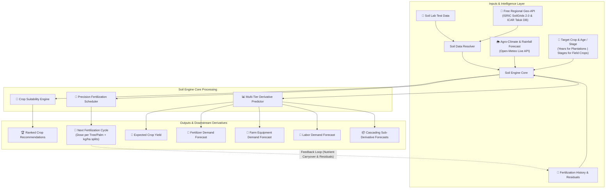

# 🌱 Soil Engine — Intelligent Agricultural & Fertilizer Prescription Platform

[](https://www.djangoproject.com/)
[](https://www.python.org/)
[](LICENSE)
[]()

**Soil Engine** is an advanced agronomic intelligence platform designed to revolutionize fertilizer prescription and agricultural demand forecasting. It ingests multi-modal data from soil lab tests (or automatically falls back to free regional geospatial APIs), agro-meteorological observations & forecasts, and historical fertilization records to generate tailored split-fertilizer schedules and multi-tier downstream economic derivatives.

---

## 🚀 Key Features

### 1. 📡 Free Regional Geo-Soil API Fallback (Taluk / Gram Panchayat Level)
* **No Soil Test? No Problem**: If a farmer does not have a lab report, the platform automatically retrieves regional soil parameters (*N, P, K, pH, Organic Carbon, Electrical Conductivity, Texture, and Micronutrients: Zn, Fe, B, Cu, Mn, S*) based on their Taluk, Gram Panchayat, or District.
* **Multi-Source Geospatial Pipeline**:
  * **ISRIC SoilGrids 2.0 REST API** (`rest.isric.org`) for global continuous soil properties at 0–30cm depth.
  * **Open-Meteo Geocoding API** for automatic location and administrative hierarchy resolution.
  * **ICAR Regional Taluk Health Card Database** covering major Indian agricultural belts (Karnataka, Maharashtra, Andhra Pradesh, Telangana, Tamil Nadu, Kerala, Punjab, Haryana, Uttar Pradesh, Bihar, Gujarat, Rajasthan).

### 2. 🌴 Plantation Age in Years & Field Crop Growth Stages
* **Plantation & Perennial Crops** (*Arecanut, Coconut, Coffee, Rubber, Mango, Black Pepper, Banana, etc.*):
  * **Age-Scaling Curves**: Scales nutrient requirements based on tree/palm age (*Year 1 Seedling: ~33% dose; Year 2: ~66%; Year 3: ~85%; Year 4+: 100% full commercial bearing dose*).
  * **Dual-Unit Dosage**: Delivers prescriptions in both **grams per palm/tree** (for direct ring/basin application) and **kg/hectare** (for bulk procurement).
* **Seasonal & Field Crops** (*Rice, Wheat, Maize, Cotton, Chickpea, Groundnut, Potato, Tomato, Chilli*):
  * **Growth Stages**: Targets the active growth phase (*Basal, Vegetative/Tillering, Flowering/Panicle Initiation, Fruiting/Grain Filling, Maturity*).

### 3. 🌦️ Free Live Weather & Rainfall Forecast (Open-Meteo API)
* **Recent Past Rainfall (7 Days)**: Tracks accumulated past precipitation to compute root-zone nutrient leaching adjustments (+15% to +30% N and +10% to +18% K).
* **Upcoming 7-Day Rainfall Forecast**: Daily precipitation forecast, rain probabilities, and max/min temperatures.
* **Agro-Meteorological Advisories**: Warns farmers when heavy rain (>50mm) is imminent to postpone urea broadcasting and prevent wash-off.

### 4. 📊 5-Tier Downstream Derivative Forecasts
1. **Crop Yield Prediction**: Expected yield (tonnes/ha and total harvest volume) adjusted for soil suitability and plantation age.
2. **Fertilizer Demand Forecast**: Total fertilizer requirement (kg) and cost (₹) broken down by fertilizer type (*Urea, DAP, MOP, SSP, Neem Cake, Micronutrients*).
3. **Farm Machinery & Equipment Demand**: Machine hours needed (tractors, rotavators, high-pressure sprayers, fertigation units, harvesters).
4. **Labor Demand Forecast**: Total person-days, activity breakdown (land prep, weeding, fertilization, spraying, harvest), and labor budget.
5. **Sub-Derivative Demand Signals**: Planting material/seed quantity, irrigation water volume (mm), packaging/storage capacity, and bio-protection inputs.

---

## 🏛️ System Architecture



---

## 🛠️ Tech Stack

* **Backend**: Python 3.10+, Django 6.1
* **Frontend**: Vanilla CSS Design System (clean agricultural theme with Inter & Outfit typography), Vanilla JavaScript
* **APIs**:
  * **ISRIC SoilGrids 2.0 REST API** (Global soil mapping)
  * **Open-Meteo Weather & Geocoding API** (Free meteorological & geospatial telemetry)
* **Agronomic Guidelines**: Indian Council of Agricultural Research (ICAR), Central Plantation Crops Research Institute (CPCRI), State Agricultural Universities (UAS Dharwad, TNAU, MPKV, PAU).

---

## 📦 Installation & Quick Start

### 1. Clone the Repository
```bash
git clone https://github.com/chinmaya-hs-98/fertilise.git
cd fertilise
```

### 2. Set Up Virtual Environment
```bash
# Windows
python -m venv venv
venv\Scripts\activate

# Linux / macOS
python3 -m venv venv
source venv/bin/activate
```

### 3. Install Dependencies
```bash
pip install -r requirements.txt
```

### 4. Run Migrations & Start Server
```bash
python manage.py migrate
python manage.py runserver
```

Open your browser and navigate to **`http://127.0.0.1:8000/`**.

---

## 🧪 Running Automated Tests

The test suite validates the Geo-Soil resolver, Open-Meteo weather integration, plantation age scaling curves, and API endpoints:

```bash
python manage.py test soil_engine
```

---

## 🌐 Public API Endpoints

| Endpoint | Method | Description | Parameters |
|---|---|---|---|
| `/api/geo-soil/` | `GET` | Geo-Soil parameter resolver (ISRIC & ICAR) | `location`, `taluk`, `district`, `lat`, `lon` |
| `/api/geo-weather/` | `GET` | Live Open-Meteo past & 7-day rainfall forecast | `location`, `lat`, `lon` |
| `/api/crops/` | `GET` | Crop database with nutrient requirements & age schedules | None |
| `/api/fertilizers/` | `GET` | Fertilizer database with N-P-K concentrations & pricing | None |

---

## 📄 License

This project is licensed under the MIT License — see the [LICENSE](LICENSE) file for details.
